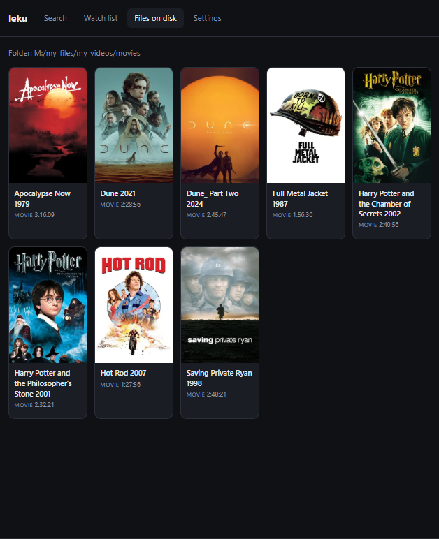
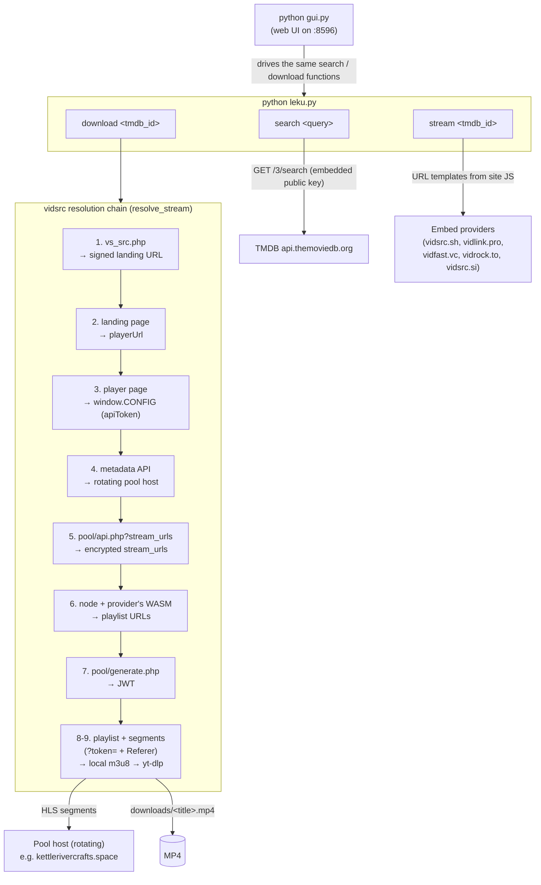

# leku — drive lekuluent.et from the CLI

A single-file CLI (`leku.py`) that drives the underlying services of
**lekuluent.et**, an Ethiopian movie/TV streaming site — so you can search
its catalog, get playable stream URLs, and download media, all from a terminal.

The site looks like a custom app, but it's a thin Next.js frontend over two
public services: **TMDB** for search/metadata and public **embed providers**
for playback. `leku.py` reproduces what the site's own player does, including
resolving the vidsrc provider chain (signed tokens, encrypted stream URLs,
WASM decryption) end to end.



## How it works



**Key details of the chain** (each hop read out of the provider's own player JS):

- The player page mints a **single-use, IP-bound `apiToken`**; the metadata
  response advertises a **rotating pool host** that serves the actual streams.
- `pool/api.php?...&stream_urls&api_token=` returns `data.stream_urls` as a
  **base64 ChaCha20 blob** plus the URL of a **per-5-minute-window WASM
  decryptor**. `leku.py` runs that wasm under Node (a port of the site's own
  `vsdec.js`) to recover the playlist URLs.
- `pool/generate.php` returns a JWT (~4 h, IP-range bound). Every playlist and
  segment request needs **both** `?token=<jwt>` and
  `Referer: <landing origin>` — bare requests get 403.
- `leku.py` rewrites a token-stamped HLS playlist to a local file and hands it
  to **yt-dlp's native HLS downloader** (which honors `--add-headers`; ffmpeg
  section downloads silently drop the Referer and fail).

## Setup

Requirements:

- **Python 3.10+** (stdlib only — no pip packages)
- **Node.js 18+** on PATH (runs the WASM stream-URL decryption)
- **yt-dlp** on PATH (HLS download; ffmpeg bundled with yt-dlp does muxing)

```bash
git clone https://github.com/<you>/leku.git
cd leku
python leku.py search "batman"   # smoke test — should print titles + TMDB ids
```

No config, no `.env`, no keys to supply — the TMDB API key it uses is the
public one lekuluent.et ships in its own client JS.

## Web GUI

`gui.py` is a local web interface over the same `leku.py` functions — a
cleaner way to browse and download than the terminal. It uses only the Python
standard library (no Flask).

```bash
python gui.py      # -> http://localhost:8596
```

What it gives you:

- **Search** movies & TV with poster thumbnails, and add results to a **watch
  list**.
- **Download** from the watch list with a **live progress bar** (yt-dlp's real
  percent). Downloads run **one at a time** through a single queue — parallel
  pulls trip the provider's captcha gate.
- **TV shows** get a **View episodes** sub-page: download the whole show,
  a single season, or individual episodes; already-downloaded episodes are
  skipped, so it doubles as resume.
- **Persistent status** across restarts: finished titles show **Downloaded**,
  and a title the provider doesn't have shows **failed** with a **Retry**
  button. State lives in `gui_data.json`; each finished file also gets a
  `<name>.mp4.leku.json` sidecar (TMDB id + poster) so the browser can show
  cover art even after you move the folder.
- **Files on disk** lists only completed `.mp4`s with their posters.
- **Settings** lets you pick any **downloads folder** (paste a full path).

All the provider resolution, captcha handling, and yt-dlp pacing is the same
code the CLI uses; the GUI just drives it.

## CLI usage

```
usage: leku.py {search,stream,download} ...

search:
  python leku.py search "batman"              # multi (movies + tv)
  python leku.py search "the office" --type tv

stream (playable embed URLs — open any in a browser to watch):
  python leku.py stream 155                   # movie by TMDB id
  python leku.py stream 1399 -s 1 -e 1        # tv season/episode

download (resolves the chain, then yt-dlp → ./downloads/<title>.mp4):
  python leku.py download 155 --type movie      # movie
  python leku.py download 1399 -s 1 -e 1       # single tv episode
  python leku.py download 1399 -s 1             # a whole season
  python leku.py download 1399 --type tv        # every episode of the show
  python leku.py download 155 --type movie --fragments 20   # quick sample
```

Workflow: `search` prints `tmdb_id  type  year  title  poster_url` — feed
the id into `stream` or `download`. The poster URL points at TMDB's public
image CDN (open it to preview the cover art; `-` means no poster on file).
`--fragments N` is handy for quick tests without pulling a full movie.

**TMDB ids are per-namespace:** movie and tv ids are independent and
collide constantly (movie 155 = The Dark Knight, tv 155 = 3rd Rock from
the Sun). So a bare `download <id>` that exists in both namespaces errors
and asks for `--type movie` or `--type tv`; an id that exists in only one
namespace needs no `--type`, and `-s`/`-e` imply tv.

For TV batches, `download` figures out season/episode counts from TMDB and
loops them, resolving a **fresh provider chain per episode** (tokens are
single-use). Episodes save as `<title> S01E01.mp4` etc.; a failed episode
is reported and the loop continues, exiting non-zero if anything failed.

### Notes & caveats

- The resolution chain is specific to the **vidsrc family** (vidsrc.sh /
  embed.vidsrc.si funnel into the same backend); the other providers are
  listed by `stream` as alternates.
- yt-dlp alone cannot crack the embed pages — the resolver is the essential part.
- **Some content is captcha-gated.** The provider serves "cold" (older/less
  popular) files behind a Cloudflare Turnstile challenge; those episodes fail
  with a clear "Turnstile captcha gate" message (a browser solves it for
  normal viewing — this CLI doesn't). Hot/recent content is ungated.
- Tokens are single-use and IP-bound, so `download` resolves a fresh chain
  every run (per episode for batch downloads).
- This tool drives the same public endpoints the site's own player drives,
  for personal use. Respect copyright in what you keep — see `legal.md`
  for the US risk profile.

## Repo layout

```
leku.py      # everything: search / stream / download + embedded wasm decryptor
gui.py       # local web UI over leku.py (http://localhost:8596)
README.md
.gitignore   # ignores downloads/ output and gui_data.json (local GUI state)
```
